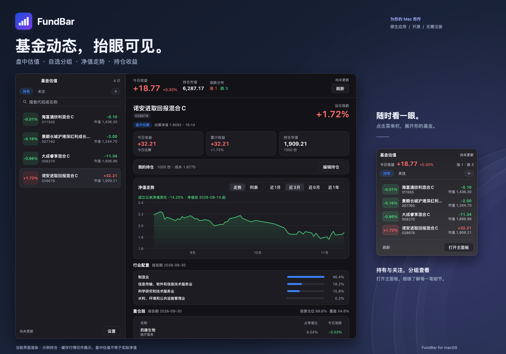

<h1 align="center">FundBar</h1>

<p align="center">
  <strong>基金动态，抬眼可见。</strong><br>
  一款开源的 macOS 菜单栏基金工具。随时速览涨跌，需要时展开细节。
</p>

<p align="center">
  <a href="https://github.com/Alickx/mygo-fundbar/actions/workflows/build.yml"></a>
  
  <a href="https://opensource.org/license/mit"></a>
</p>

<p align="center">
  <a href="https://github.com/Alickx/mygo-fundbar/releases"><strong>下载 macOS 版</strong></a> ·
  <a href="#功能亮点">功能亮点</a> ·
  <a href="#快速上手">快速上手</a> ·
  <a href="docs/DEVELOPMENT.md">开发指南</a> ·
  <a href="https://github.com/Alickx/mygo-fundbar/issues">反馈问题</a>
</p>



<p align="center">
  <sub>当前界面渲染与代码排版，使用示例持仓及缓存行情；盘中估值不等于实际净值。</sub><br>
  <a href="docs/promo/main-dark.png">深色界面原图</a> ·
  <a href="docs/promo/main-light.png">浅色界面原图</a>
</p>

工作时看一眼菜单栏，就能了解持仓收益或自选平均涨跌。点击展开小窗，再点一只基金，即可查看走势、持仓与行业配置。

**无需注册，无需配置 API Key。** 添加基金即可开始使用，自选与手动录入的持仓保存在本机。基于 Go 与 [MyGo](https://github.com/egoist/mygo) 构建原生界面，支持 Apple Silicon 与 Intel Mac。

## 功能亮点

| 想了解什么 | FundBar 帮你看 |
| --- | --- |
| **今天表现如何** | 菜单栏显示持仓收益或自选平均涨跌，点击展开基金小窗，顶部附上证、沪深 300 与创业板的涨跌。 |
| **盘中大致涨跌** | 根据季报重仓股与最新行情推算估值，当日净值更新后切换为已公布净值；并记下估值与当晚净值的差距，告诉你它最近有多准。 |
| **持有和关注哪些** | 按名称或代码搜索添加，一次粘贴多个代码可批量添加，拖动排序；用分组区分持有与关注，小窗和主面板都能切换。 |
| **最近走势怎样** | 查看近 1 月到成立以来的历史净值，附最大回撤、年化波动与年化收益，以及净值修复进度；可叠加最多三只基金对比，分红按前复权计算。 |
| **持仓赚亏多少** | 录入份额与成本价，或记下每笔买入、卖出与分红，由应用算出份额、成本与已实现收益；查看当日收益、累计收益及持仓市值。 |
| **基金投向哪里** | 展示季报重仓股、行业配置与个股的行业概念；「组合透视」把持有的基金合起来，看整体押在哪些行业和股票上、基金之间重合多少。 |
| **什么时候该看一眼** | 可选的系统通知：盘中涨跌超过阈值、当晚净值公布、持仓触及止盈或止损线。 |

也照顾日常使用的小细节：外观可固定为浅色或深色、也可跟随系统切换，毛玻璃侧栏、可调侧栏宽度、登录时自动启动、可选的全局快捷键、菜单栏可以只留图标、一键复制不含金额的今日收益图、换电脑时带得走的备份文件，以及内置的版本检查与更新。

## 安装

支持 **Apple Silicon 与 Intel Mac**，使用同一个通用安装包。

1. 前往 [Releases](https://github.com/Alickx/mygo-fundbar/releases) 下载 `.dmg` 文件。
2. 打开安装包，将 **FundBar** 拖入 **Applications（应用程序）**。
3. 启动 FundBar，在菜单栏找到应用图标。

<details>
<summary>首次打开被 macOS 拦截？</summary>

当前默认构建使用 ad-hoc 签名，尚未经过 Apple 公证。确认安装包来自本仓库后，可在终端执行以下命令，再重新打开应用：

```sh
xattr -dr com.apple.quarantine /Applications/FundBar.app
```

这一操作只需在首次手动安装时执行一次：之后的版本由应用自行下载安装，不会附带隔离标记。

</details>

## 快速上手

1. **添加基金**：在左侧搜索框输入基金代码或名称，选择搜索结果加入自选；一次粘贴多个六位代码可以批量添加。
2. **查看详情**：点击自选基金，查看净值走势、重仓股与行业配置；走势图上的「对比」可以叠加其他基金。
3. **录入持仓**：在「我的持仓」中点击「录入持仓」，填写持有份额和每份成本价。买卖过多次的，点「记一笔交易」逐笔记录，份额与成本自动计算。
4. **分组关注**：点击分组栏末尾的「＋」新建分组，即可把只想关注、未持有的基金放进去。分组里只显示涨跌与净值，不记录持仓；在分组内搜索添加的基金不会计入菜单栏收益。
5. **随时速览**：关闭主窗口后，应用继续留在菜单栏。点击图标查看概览，右键打开刷新、分享、设置与退出菜单。
6. **开启提醒**：在设置的「提醒」里打开盘中涨跌或净值公布提醒；止盈、止损线在每只基金的「我的持仓」里单独填写。

在设置中还可以切换浅色 / 深色 / 跟随系统的外观、开启登录时自动启动与全局快捷键、选择菜单栏显示的内容、导出或导入备份、清空缓存或打开本地数据目录。

| 快捷键 | 操作 |
| --- | --- |
| `⌘ R` | 刷新数据 |
| `⌘ ,` | 打开设置 |
| `⌘ W` | 关闭主窗口，保留菜单栏运行 |
| `⌘ Q` | 退出应用 |
| `⌃ ⌥ F` | 在任何应用中打开或收起小窗（需在设置中开启） |

除全局快捷键外，快捷键在应用窗口处于活动状态时使用。

## 关于估值与数据

FundBar 使用天天基金 / 东方财富的基金资料与历史净值，以及腾讯财经的股票行情。盘中估值由最新可获取季报中的前十大重仓股加权推算，再按基金的股票仓位折算，依赖已披露持仓，可能与基金实际净值存在偏差。

当可用于估算的重仓股占基金净资产比例不足 **20%** 时，应用默认仅显示已公布净值；ETF 联接、QDII 等基金可能因此没有盘中估值。设置里可以打开「低覆盖也显示估值」，让这类基金也显示盘中估算，并在净值行与小窗里注明实际覆盖率。交易时段约每分钟刷新行情，其余时间约每 15 分钟刷新；周末与法定节假日不按交易时段刷新。

自选列表、持仓、交易记录与数据缓存保存在本机：

```text
~/Library/Application Support/FundBar/
```

换电脑时，在设置里导出一份备份带走即可。估值方法、收益口径、提醒规则与接口清单见 [数据与估值说明](docs/DATA.md)。

> 估值仅供参考，实际净值以基金公司公布为准。本项目不构成投资建议。

## 从源码运行

在 macOS 上安装 **Go 1.27.3 或更新版本**，然后运行：

```sh
git clone https://github.com/Alickx/mygo-fundbar.git
cd mygo-fundbar
go run .
```

构建 macOS 通用应用与安装包：

```sh
go tool mygo build -platform darwin/universal
```

产物位于 `build/darwin-universal/`。测试、调试工具与签名发布流程见 [开发指南](docs/DEVELOPMENT.md)。

## 参与贡献

欢迎通过 [Issues](https://github.com/Alickx/mygo-fundbar/issues) 反馈问题、提出建议，或提交 [Pull Request](https://github.com/Alickx/mygo-fundbar/pulls) 改进项目。

反馈问题时，请附上 macOS 版本、FundBar 版本和复现步骤；涉及数据显示时，请一并说明基金代码与数据日期。提交代码前，请按 [开发指南](docs/DEVELOPMENT.md#质量检查) 完成本地检查。

## 致谢

- [MyGo](https://github.com/egoist/mygo) — 提供 Go 原生桌面 UI 框架。
- 天天基金、东方财富与腾讯财经 — 提供应用使用的基金资料与行情数据。

## License

项目代码采用 [MIT License](https://opensource.org/license/mit)。第三方数据的使用受各提供方条款约束。
