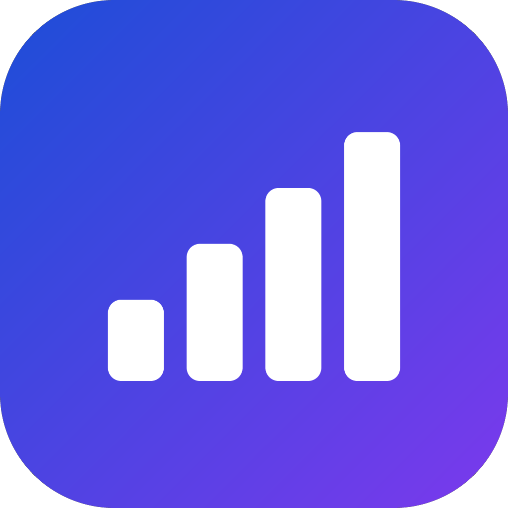
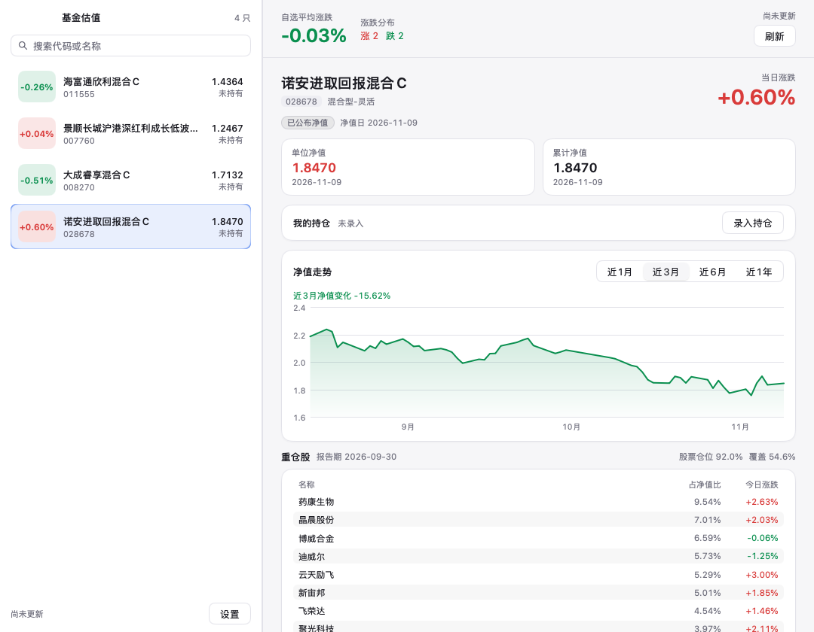

<p align="center">
  
</p>

<h1 align="center">FundBar</h1>

<p align="center">
  <strong>在 Mac 菜单栏，关注你的基金。</strong><br>
  盘中估值、自选基金、净值走势与持仓收益，抬眼可见。
</p>

<p align="center">
  <a href="https://github.com/Alickx/mygo-fundbar/actions/workflows/build.yml"></a>
  
  <a href="https://opensource.org/license/mit"></a>
</p>

<p align="center">
  <a href="https://github.com/Alickx/mygo-fundbar/releases">下载应用</a> ·
  <a href="#快速上手">快速上手</a> ·
  <a href="docs/DEVELOPMENT.md">开发指南</a> ·
  <a href="https://github.com/Alickx/mygo-fundbar/issues">反馈问题</a>
</p>

---

FundBar 是一款开源的 macOS 菜单栏基金工具。把关心的基金加入自选，即可查看盘中估值、已公布净值和历史走势；录入持有份额与成本价后，还能随时了解持仓收益。

应用使用 Go 与 [MyGo](https://github.com/egoist/mygo) 构建原生界面，支持浅色与深色外观，无需注册账号或配置 API Key。

## 界面预览

<picture>
  <source media="(prefers-color-scheme: dark)" srcset="docs/screenshot-dark.png">
  <source media="(prefers-color-scheme: light)" srcset="docs/screenshot.png">
  
</picture>

<p align="center">
  <sub>浅色与深色外观随系统切换；截图仅用于界面展示。</sub>
</p>

## 功能亮点

- **菜单栏速览** — 直接显示持仓收益或自选平均涨跌，点击展开基金列表，再点一只基金进入详情。
- **盘中估值** — 根据季报重仓股与最新股票行情推算涨跌；当日净值公布并更新后，自动显示已公布净值。
- **自选管理** — 按代码或名称搜索添加，拖动调整顺序，右键移出列表。
- **净值走势** — 查看近 1 月、3 月、6 月或 1 年的历史净值，支持曲线与每日列表，悬停查看数值。
- **持仓收益** — 手动录入份额与成本价，查看当日收益、累计收益和持仓市值。
- **持仓与行业** — 查看季报重仓股、行业配置，以及个股所属行业和概念。
- **融入 macOS** — 毛玻璃侧栏、自适应深色模式、可调侧栏宽度，支持登录时自动启动。

## 安装

支持 **Apple Silicon 与 Intel Mac**，使用同一个通用安装包。

1. 前往 [Releases](https://github.com/Alickx/mygo-fundbar/releases) 下载 `.dmg` 文件。
2. 打开安装包，将 **FundBar** 拖入 **Applications（应用程序）**。
3. 启动 FundBar，在菜单栏找到应用图标。

<details>
<summary>首次打开被 macOS 拦截？</summary>

当前默认构建使用 ad-hoc 签名，尚未经过 Apple 公证。确认安装包来自本仓库后，可在终端执行以下命令，再重新打开应用：

```sh
xattr -dr com.apple.quarantine /Applications/FundBar.app
```

</details>

## 快速上手

1. **添加基金**：在左侧搜索框输入基金代码或名称，选择搜索结果加入自选。
2. **查看详情**：点击自选基金，查看净值走势、重仓股与行业配置。
3. **录入持仓**：在「我的持仓」中点击「录入持仓」，填写持有份额和每份成本价。
4. **随时速览**：关闭主窗口后，应用继续留在菜单栏。点击图标查看概览，右键打开刷新、设置与退出菜单。

在设置中可开启登录时自动启动、清空缓存或打开本地数据目录。

| 快捷键 | 操作 |
| --- | --- |
| `⌘ R` | 刷新数据 |
| `⌘ ,` | 打开设置 |
| `⌘ W` | 关闭主窗口，保留菜单栏运行 |
| `⌘ Q` | 退出应用 |

快捷键在应用窗口处于活动状态时使用。

## 关于估值与数据

FundBar 使用天天基金 / 东方财富的基金资料与历史净值，以及腾讯财经的股票行情。盘中估值由最新可获取季报中的前十大重仓股加权推算，依赖已披露持仓，可能与基金实际净值存在偏差。

当可用于估算的重仓股占基金净资产比例不足 **20%** 时，应用仅显示已公布净值。ETF 联接、QDII 等基金可能因此没有盘中估值。交易时段约每分钟刷新行情，其余时间约每 15 分钟刷新。

自选列表、手动录入的持仓与数据缓存保存在本机：

```text
~/Library/Application Support/FundBar/
```

估值方法、显示规则与接口清单见 [数据与估值说明](docs/DATA.md)。

> 估值仅供参考，实际净值以基金公司公布为准。本项目不构成投资建议。

## 从源码运行

在 macOS 上安装 **Go 1.27.3 或更新版本**，然后运行：

```sh
git clone https://github.com/Alickx/mygo-fundbar.git
cd mygo-fundbar
go run .
```

构建 macOS 通用应用与安装包：

```sh
go tool mygo build -platform darwin/universal
```

产物位于 `build/darwin-universal/`。测试、调试工具与签名发布流程见 [开发指南](docs/DEVELOPMENT.md)。

## 参与贡献

欢迎通过 [Issues](https://github.com/Alickx/mygo-fundbar/issues) 反馈问题、提出建议，或提交 [Pull Request](https://github.com/Alickx/mygo-fundbar/pulls) 改进项目。

反馈问题时，请附上 macOS 版本、FundBar 版本和复现步骤；涉及数据显示时，请一并说明基金代码与数据日期。提交代码前，请按 [开发指南](docs/DEVELOPMENT.md#质量检查) 完成本地检查。

## 致谢

- [MyGo](https://github.com/egoist/mygo) — 提供 Go 原生桌面 UI 框架。
- 天天基金、东方财富与腾讯财经 — 提供应用使用的基金资料与行情数据。

## License

项目代码采用 [MIT License](https://opensource.org/license/mit)。第三方数据的使用受各提供方条款约束。
