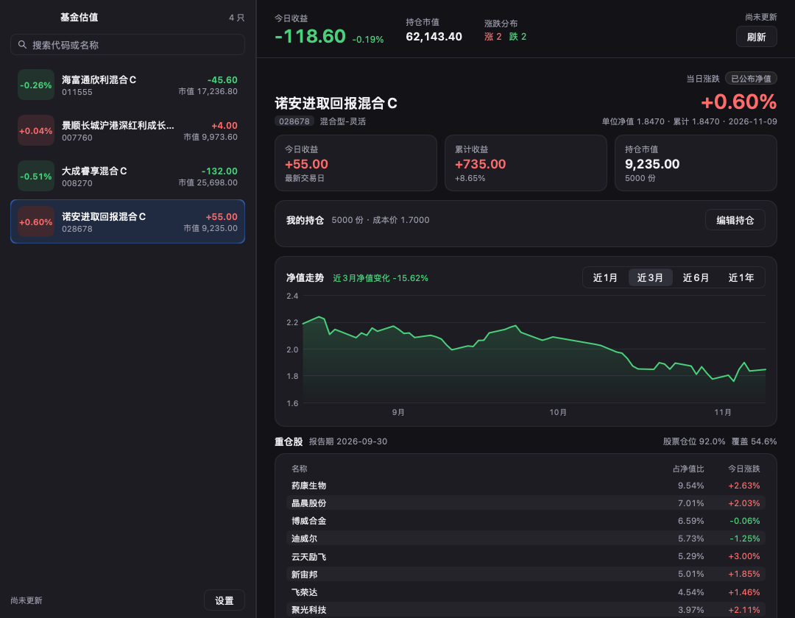
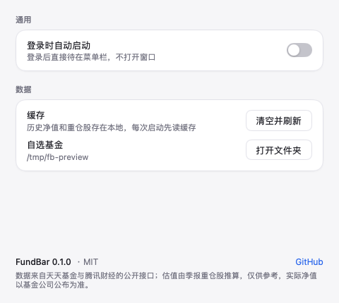

# FundBar 基金估值

[](https://github.com/Alickx/mygo-fundbar/actions/workflows/build.yml)

一个住 macOS 菜单栏的基金估值小工具：实时估值、自选列表、历史净值曲线，状态栏直接显示今天赚了多少。





（截图里的持仓和收益是示例数字。）

## 为什么自己算估值

2023 年之后各大平台的「实时估值」陆续下线，官方接口也没了：

| 接口 | 现状 |
|---|---|
| `fundgz.1234567.com.cn/js/{code}.js` | 404，已下线 |
| `fundmobapi.eastmoney.com/…/FundMNFInfo` | 200，但 `GSZ`/`GSZZL` 全是 `null` |
| 蛋卷 `/djapi/fund/estimate/{code}` | 需要登录 |
| 雪球 `quote.json` | 需要 token |

所以本项目的估值是**自己算的**：

```
估值涨跌% = Σ(重仓股占净值比例 × 该股票今日涨跌%) ÷ Σ(重仓股占净值比例)
```

也就是用最新季报的前十大重仓股，按占比归一化后加权。净值本身仍来自官方（当日净值每天晚上公布），估值只在净值公布前替代它。

### 实测精度（2026-11-09 收盘价 vs 当日公布净值）

| 基金 | 类型 | 重仓覆盖 | 估算 | 实际 | 误差 |
|---|---|---|---|---|---|
| 161725 招商中证白酒 | 指数 | 86.4% | -0.69% | -0.63% | -0.06pp |
| 110022 易方达消费行业 | 股票 | 72.5% | -0.65% | -0.63% | -0.02pp |
| 003096 中欧医疗健康C | 偏股混合 | 74.8% | -1.16% | -0.84% | -0.32pp |
| 005827 易方达蓝筹精选 | 偏股混合 | 42.6% | -0.43% | -0.21% | -0.22pp |

覆盖越低误差越大。覆盖不到 20% 的基金（如 ETF 联接、QDII）不显示估值，只显示官方净值。

## 功能

- **实时估值**：交易时段每 45 秒刷新，收盘后显示已公布净值；数字滚动更新
- **自选列表**：搜索代码/名称添加，右键移出，拖动排序，侧栏宽度可拖
- **历史净值**：近 1 月 / 3 月 / 6 月 / 1 年，鼠标划过读数
- **今日收益**：填了份额和成本价后，状态栏显示当日收益，面板显示累计收益
- **状态栏**：左键开面板，右键出菜单（含每只基金的涨跌）
- **设置窗口**（`Cmd+,`）：登录时自动启动、清空缓存、打开数据目录
- **毛玻璃侧栏**：`VibrancySidebar` 材质，跟随桌面壁纸；深色模式自动适配

## 数据来源

| 用途 | 接口 |
|---|---|
| 基金名 / 全部历史净值 / 股票仓位 / 持仓代码 | `fund.eastmoney.com/pingzhongdata/{code}.js` |
| 前十大重仓股及占净值比例 | `fundf10.eastmoney.com/FundArchivesDatas.aspx?type=jjcc` |
| 个股实时价格（A 股 + 港股，一次请求批量） | `qt.gtimg.cn/q=sh600519,sz000858,hk00700` |
| 基金搜索 | `fundsuggest.eastmoney.com/FundSearch/api/FundSearchAPI.ashx` |

都是公开接口，不需要 key；请控制频率，别把人家打挂。

## 安装

从 [Releases](https://github.com/Alickx/mygo-fundbar/releases) 下载 `fundbar-<version>.dmg`，拖进 Applications。

当前是 **ad-hoc 签名**（没有 Apple 公证），从网上下载后首次打开会被 Gatekeeper 拦下，一条命令放行：

```sh
xattr -dr com.apple.quarantine /Applications/FundBar.app
```

自己本地构建的副本没有 quarantine 属性，直接双击即可。

## 从源码构建

需要 Go 1.27.3+：

```sh
go run .                                        # 开发，直接跑
go tool mygo build -platform darwin/universal   # 出 .app 和 dmg
open build/darwin-universal/FundBar.app
```

产物在 `build/darwin-universal/`：`FundBar.app`（24 MB，arm64 + x86_64 通用二进制）和 `fundbar-0.2.0.dmg`（8 MB）。

自选基金存在 `~/Library/Application Support/FundBar/funds.json`，抓到的数据缓存在同目录 `cache/`，删掉即可重来。

### 签名与公证

默认 `-sign -`（ad-hoc），只保证本机能跑。要让别人下载后直接双击就能打开，需要 Apple Developer Program 的 Developer ID 证书：

```sh
# 列出本机可用的签名身份
security find-identity -v -p codesigning

go tool mygo build -platform darwin/universal \
  -sign "Developer ID Application: Your Name (TEAMID)"
```

公证则在 `mygo.json` 里加 `"macos": {"notarize": {"keychainProfile": "AC_PASSWORD"}}`，凭据用 `xcrun notarytool store-credentials` 存好。

CI 已经预留了这条路：在仓库 Secrets 里放 `MACOS_SIGNING_IDENTITY`、`MACOS_CERT_P12`（base64）、`MACOS_CERT_PASSWORD`，工作流会自动导入证书并签名；这些 secret 不存在时构建 ad-hoc 版本。

## 自动构建

`.github/workflows/build.yml` 在 macOS runner 上：

1. `gofmt -l` / `go vet` / `mygo vet` / `go test` 全部通过才继续
2. 构建通用二进制（arm64 + x86_64）和 dmg
3. `codesign --verify --deep --strict` 校验签名
4. 上传 artifact（dmg + app）
5. 打 `v*` tag 时自动建一个 draft Release，附上 dmg

```sh
git tag v0.2.0 && git push origin v0.2.0
```

## 开发

```sh
go test ./...                          # 单元测试（估值算法、接口解析、界面构建）
go tool mygo vet .                     # 检查 native UI 的构建生命周期
go tool mygo build -debug              # 保留开发特性
go run ./tools/probe 161725 005827     # 对比估算值和公布净值
go run ./tools/shot /tmp/shot.png      # 不开窗口，把界面渲染成 PNG
                                       # 参数：dark | settings | edit | search | empty
FUNDBAR_DIR=/tmp/preview FUNDBAR_W=900 go run ./tools/shot /tmp/narrow.png
go run ./tools/genicon                 # 重新生成 resources/ 下的图标
```

代码结构：

```
main.go                    窗口 / 菜单栏图标 / 应用菜单
internal/model/            数据类型与估值算法（纯函数）
internal/source/           天天基金、腾讯行情的适配器
internal/store/            funds.json 与缓存
internal/app/app.go        状态、刷新调度、汇总
internal/app/view.go       界面
internal/app/chart.go      净值曲线
internal/app/window.go     菜单栏菜单、菜单动作
tools/probe                估值精度自查
tools/shot                 离屏渲染截图
tools/genicon              生成菜单栏图标和 App 图标
```

界面用 MyGo 的原生 UI（Go 直接画，没有 webview、没有 JS），所以启动快、内存低。

刷新频率：交易时段约 50–60 秒，其余时间 15 分钟；基金档案（历史净值、重仓股）20 分钟才重新拉一次，每次刷新只发一个批量行情请求。

## 免责

估值由季报重仓股推算，**不是官方数据**，仅供参考。实际净值以基金公司公布为准。本项目不构成任何投资建议。

## License

MIT
